# Plataboy 26

A pocket game console built around an 8-pin, 10-cent RISC-V microcontroller (CH32V003:
16 KiB flash, 2 KiB RAM), a 128×64 OLED and a coin cell. It was made as merch for
Platanus Hack 26.

<p align="center">
  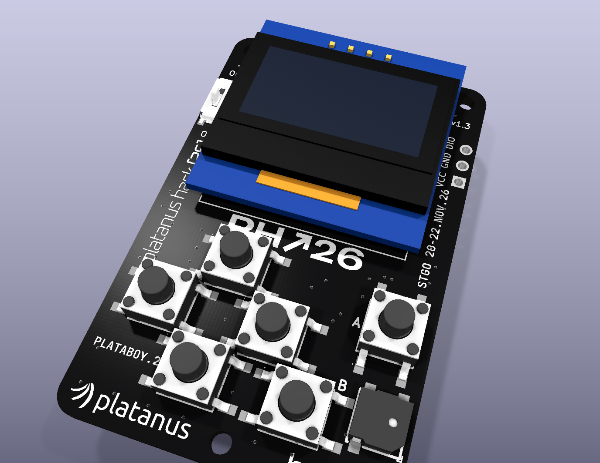
  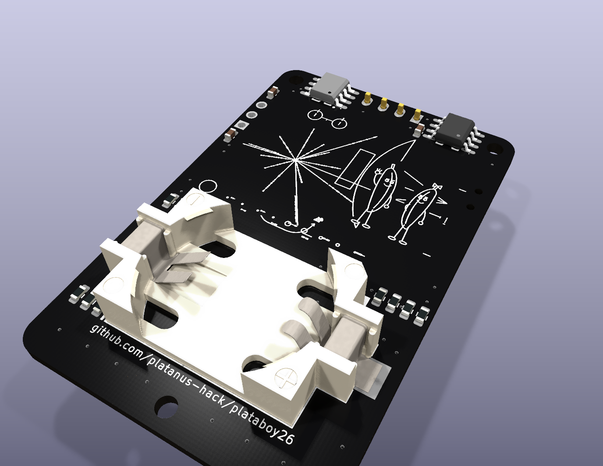
</p>

| | |
|---|---|
| CPU | WCH CH32V003J4M6: 32-bit RISC-V (QingKe V2A core, RV32EC, no hardware multiplier), 8-pin SOP, up to 48 MHz |
| Flash | 16 KiB, holds the game being played |
| RAM | 2 KiB |
| Storage | 128 KiB I2C EEPROM (AT24CM01): the compressed game library, game data and saves |
| Display | 0.96" monochrome OLED, 128×64, SSD1306 over I2C at 400 kHz |
| Input | four directions, A and B |
| Sound | magnetic buzzer on one pin |
| Power | CR2032 coin cell or, better, a rechargeable LIR2032 (see the note below); slide switch |
| Size | 35.56 × 54.8 mm, two layers |

> [!IMPORTANT]
> **About the battery.** The console draws far more current than a coin cell is made for:
> 17 mA in the menu and up to 33 mA in a game with a bright screen, measured on a board at 3.3 V
> (about 20 mA in a typical game). Coin cells are rated at a fraction of a milliamp.
>
> - **The CR2032 that comes with the board does not last long.** Expect a few hours of play,
>   about 6 at best, and less with bright games or sound. Under this load its voltage sags, so
>   the screen dims and the low-battery beep (below 2.8 V) comes well before the cell is empty.
>   It cannot be recharged: never put a CR2032 in a charger.
> - **A rechargeable LIR2032 is the better choice.** It holds less (35–70 mAh depending on the
>   brand, against roughly 120 mAh usable from a CR2032 at this current), so a charge gives
>   about 2 to 3 hours, but it delivers the current without sagging and can be recharged
>   hundreds of times in an external LIR2032 charger. It fits the same holder with no changes:
>   the board, like the original console, is designed for either cell.
>   A source of good cells: [this AliExpress listing](https://www.aliexpress.com/item/1005008569843235.html).
>
> To stretch either one, lower the contrast in the menu's Settings card (the lowest level takes
> the typical draw from about 20 mA to 12 mA) and switch the console off when not playing. These
> play times are estimates from the measured current and typical cell capacities, not from
> timed runs.

This repository holds everything needed to build one and to write games for it:

| | |
|---|---|
| [`hardware/`](hardware/) | board rev. 1.3.1: circuit, PCB, manufacturing package, checks, 3D model |
| [`games/`](games/) | the ported games, the starter template and the board test programs |
| [`firmware/`](firmware/) | the game library: menu, loader kernel and the packer that fills the EEPROM |
| [`sim/`](sim/) | a simulator that runs the unmodified firmware binaries (CLI and browser) |
| [`art/`](art/) | boot animation and the menu cards of the games |
| [`tools/`](tools/) | `setup.sh`, which downloads the RISC-V GCC toolchain |

## Based on wagiminator's CH32V003 Mini Game Console

The console is a derivative of the
**[CH32V003 Mini Game Console](https://github.com/wagiminator/CH32V003-GameConsole)** by
Stefan Wagner (wagiminator), published under
[CC BY-SA 3.0](https://creativecommons.org/licenses/by-sa/3.0/). The original board (rev. 1.1
here), its driver files and its "Tiny" games (ports of the
[TinyJoypad](https://www.tinyjoypad.com/) games by Daniel Champagne) are his work. The board in
this repository is shared under the same license.

### What changed from the original

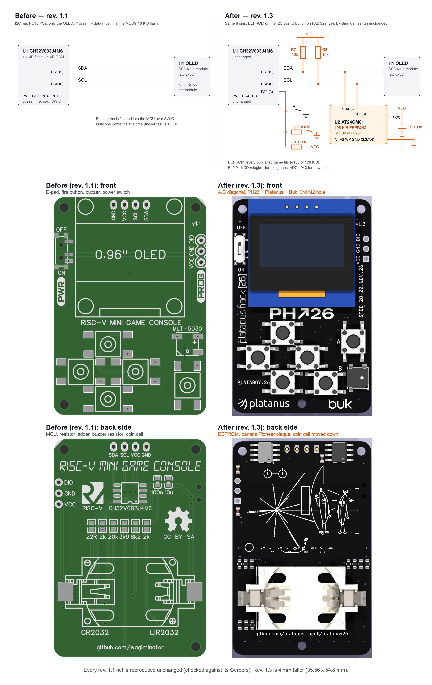

**Hardware** (details and the checks behind each point in [`hardware/README.md`](hardware/README.md)):

- **External memory.** A 128 KiB I2C EEPROM (AT24CM01) with its decoupling capacitor, on the
  OLED's bus. The original holds one game at a time in the MCU's 16 KiB of flash; the EEPROM
  holds a compressed library of games, their data and their saves. No MCU pin changes.
- **I2C pull-ups** on the board (2 × 10 kΩ). The original relied on those of the OLED module.
- **A second action button, B.** All eight MCU pins were taken, so B shares the pin of A through
  a resistor divider and is read with the ADC. Games written for the original see only A and run
  unchanged.
- **Parts moved.** A and the buzzer moved to make room for B (A up-right, B down-left, buzzer in
  the bottom-right corner). Every other part keeps its original position, and every original net
  is reproduced (checked against the original Gerbers).
- **Board 4 mm taller** (35.56 × 54.8 mm), with three M2 mounting holes: top corners and bottom
  centre.
- **LCSC footprints** for every assembled part, so that the assembly house places them as drawn.
  That check found the coin cell holder reversed in the first layout.
- **New artwork**: black solder mask, white silkscreen, event logos on the front, a banana
  version of the Pioneer plaque on the back.
- **Generated, not drawn.** The circuit is a Python (SKiDL) file and the PCB is placed, routed
  and checked by scripts (`hardware/make.sh`).

**Software:**

- **Game library firmware.** A menu with a boot animation and a picture card per game. Choosing a
  game decompresses it from the EEPROM into the MCU's flash through a loader kernel of under
  1 KiB, in one to two seconds. UP + DOWN held for two seconds returns to the menu.
- **Driver additions** shared by all games (`games/common/`): the B button, joypad thresholds
  calibrated per board at power-on, a low-battery beep, a shorter buzzer pulse that draws less
  from the coin cell, and a CPU-exception handler that returns to the menu.
- **Larger games than 16 KiB allows**: code overlays and data read from the EEPROM, and fixed
  save slots per game.
- **A simulator** of the whole console, to develop without the hardware.

## Board rev. 1.3.1

<p align="center">
  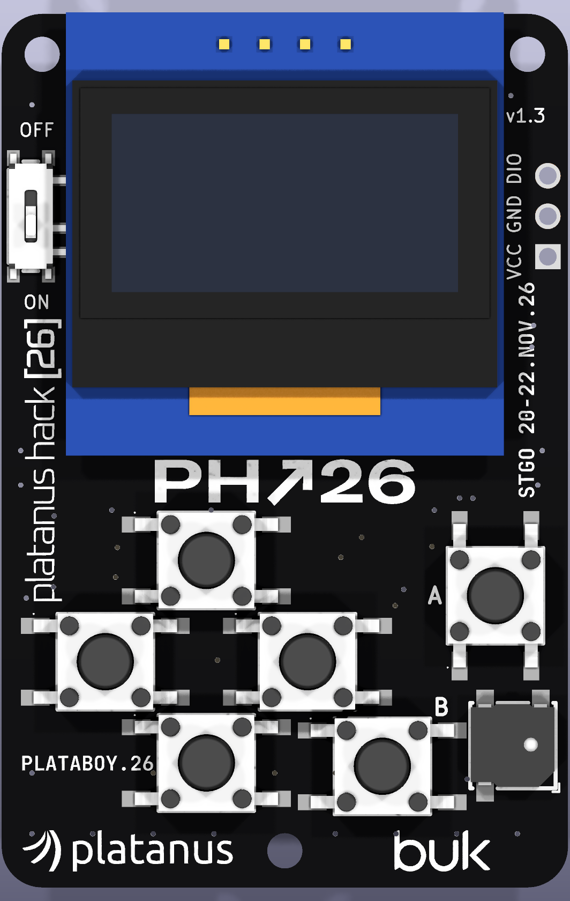
  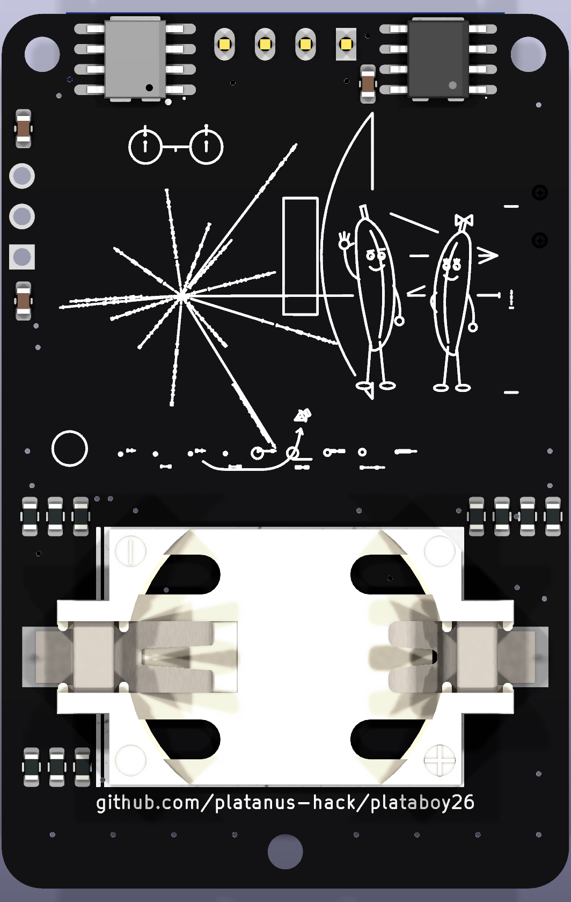
</p>

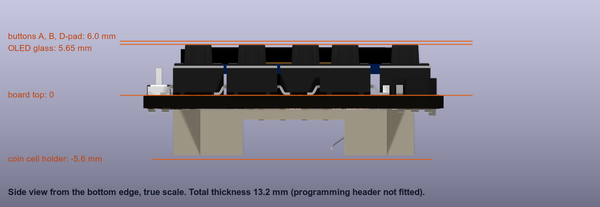

| Signal | Pin | Circuit |
|---|---|---|
| OLED + EEPROM, SDA / SCL | PC1 / PC2 | SSD1306 128×64 module at I2C 0x3C; AT24CM01 at 0x50 / 0x51; 10 kΩ pull-ups |
| Joypad | PC4 (ADC ch. 2) | each direction connects VCC through 8k2 (U) / 3k9 (D) / 20k (R) / 2k (L), 2k pull-down |
| A / B | PA2 (ADC ch. 0) | A: switch to GND. B: 100 kΩ to GND against a 10 kΩ pull-up (0.91 VDD) |
| Buzzer | PA1 | MLT-5030 magnetic transducer from VCC through 22 Ω, active low |
| Supply, programming | | CR2032 (3.0 V) or LIR2032 (3.6 V); SWIO on PD1 (WCH-LinkE) |

The ready-to-order package (Gerbers, BOM and pick-and-place for JLCPCB, assembly drawings, order
sheet, STEP, KiCad board) is in [`hardware/release/`](hardware/release/). An interactive 3D
view is in `hardware/doc/3d/` (`python3 -m http.server`, then open `viewer.html`).

## Games

Each folder under `games/` builds one `.bin` for the console. The covers are the cards the menu
shows (the title screen where a game has no card).

| | Game | What it is | Original |
|---|---|---|---|
| 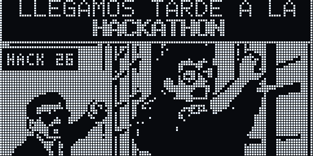 | **Llegamos tarde**<br>`games/llegamostarde/` | You arrived late to the hackathon and the guard locked the doors: climb the glass building, dodging what falls from the offices, with the guard climbing after you. Platanus Hack 26 edition, with the Platanus team as characters. | "Llegamos tarde a la hackathon" by [paoloose](https://github.com/paoloose/platanus-hack-25-arcade), Platanus Hack 25 arcade. No license yet; its sprites are fetched at build time |
| 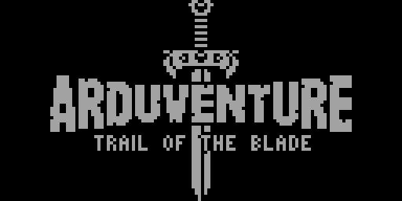 | **Arduventure**<br>`games/arduventure/` | A full RPG with an overworld, battles and a save game. Its code is loaded from the EEPROM in overlays as the game moves between title, overworld, menus and battles. | [TEAM a.r.g.](https://github.com/Team-ARG-Museum/ID-46-Arduventure), Arduboy. Code MIT; story and art © TEAM a.r.g., used with permission. Fetched at build time, not kept here |
| 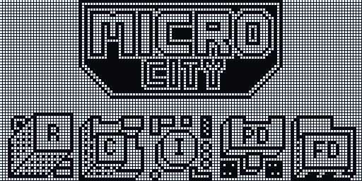 | **MicroCity**<br>`games/microcity/` | A city simulation: zone residential, commercial and industrial areas, connect them to power plants and roads, keep the budget and fight fires. Saves the city. | [James Howard](https://github.com/jhhoward/MicroCity), Arduboy, GPL-3.0. Fetched at build time and patched |
|  | **Just One Boss**<br>`games/justoneboss/` | Duel the magic mirror on a stage of 8 × 5 tiles: collect the magic tiles while dodging his cards, lasers, flowers, coins and reflections, through four phases. | [ayla~nonsense](https://github.com/aylanonsense/just-one-boss), PICO-8. Logic rewritten as bytecode; the cart is fetched for its sound effects |
|  | **Hopper**<br>`games/hopper/` | Jump from panel to panel and keep going up; fall off the bottom and the game is over. Keeps the ten best scores. | [OBONO](https://github.com/obono/ArduboyWorks/tree/master/hopper), Arduboy, MIT (`LICENSE.hopper`) |
| 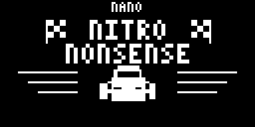 | **Nitro Nonsense**<br>`games/nitro_nonsense/` | A four-car 3D racer seen from behind, with nitro on A and a cannon on B. First to three wins. | Written for this console by [aberguecio](https://github.com/aberguecio/nitro-nonsense-plataboy); see its `README.md` and `THIRD_PARTY.md` |
| 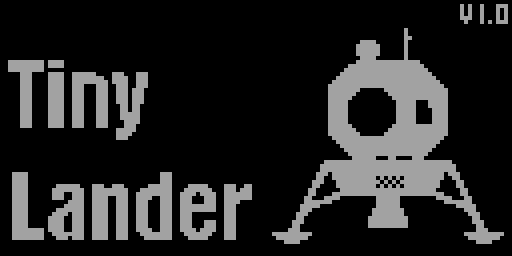 | **The Tiny games**<br>`games/tiny/` | The 12 games of the original console: Invaders, Arkanoid, Pacman, Tris, Boulder, Bubble, Doom, Karate, Lander, Run, Shooter and Conway's Game of Life. Rebuilt from the unmodified sources with the driver additions. | [Stefan Wagner](https://github.com/wagiminator/CH32V003-GameConsole), CC BY-SA 3.0. Invaders, Arkanoid, Pacman and Tris were first written by [Daniel Champagne](https://www.tinyjoypad.com/) for the ATtiny85, and Lander by [tscha70](https://github.com/tscha70/TinyLanderV1.0) |

Also under `games/`:

| Folder | |
|---|---|
| `template/` | "Catch", the starter game: copy it to start your own (`make new NAME=my_game`) |
| `common/` | driver additions shared by all games |
| `board_test/`, `eeprom_test/`, `cpi_bench/` | board bring-up test, EEPROM test, CPU timing calibration |

The library shipped on the boards (`firmware/library.full.json`, `make -C firmware full`) holds
Llegamos tarde, Arduventure, MicroCity, Just One Boss, Hopper, Tiny Lander, Tiny Conway and
Nitro Nonsense. Compressed, they fill the 128 KiB EEPROM to the last 125 bytes.

## Quick start

Needs a C compiler, Node 18 or later, python3 and curl (macOS or Linux). Nothing is installed
outside this folder.

```sh
make setup                           # once: RISC-V toolchain into tools/ + the simulator CLI
make play                            # the published games in the browser → http://localhost:8088/
```

`make play` alone works right after cloning: the browser core (`sim/web/chsim.wasm`) and the game
binaries are in the repository.

To write a game:

```sh
make new NAME=my_game                # copy of games/template
cd games/my_game
make sim                             # builds and serves it; run `make` in another terminal
                                     # after editing src/main.c and the browser reloads
make test                            # headless 5 s run + screenshot to bin/screen.png
make flash                           # real hardware via WCH-LinkE (pip install rvprog)
```

`make check` at the top level runs the simulator's regression check and the firmware's
end-to-end tests.

Controls in the simulator: arrows / WASD = joypad, Space / X = A, Z / C = B, P = pause,
R = power-cycle, F = fullscreen, F2 / F4 = save / load state. Gamepads and touch also work.

Building the game library and flashing it are separate steps.

**Build** (macOS or Linux; on Windows, in WSL):

```sh
make -C firmware                     # default library → firmware/build/flash.bin, eeprom.bin, writer/
make -C firmware test                # end-to-end tests in the simulator
```

**Flash** a built library. You need a **WCH-LinkE** programmer (the "E" version, in RISC-V
mode; for example [this one on AliExpress](https://www.aliexpress.com/item/1005005180653105.html)),
wired to the board's VCC, GND and DIO pads. This step needs no toolchain, only the built files
and a flashing tool you install yourself: [`rvprog`](https://pypi.org/project/rvprog/)
(`pip install rvprog`) or [`wlink`](https://github.com/ch32-rs/wlink).

```sh
make flash                           # Linux / macOS, from firmware/build (B=build-full for another)
make dist                            # → firmware/dist/plataboy26-default/ and .zip
```

`make dist` makes a folder with the built library, `flash.sh` (Linux / macOS), `flash.bat`
(Windows) and a `README.txt` with the driver setup for each system. Copy it to any computer and
run the script there: it writes the EEPROM library in chunks, then the firmware, board after
board. The folder holds only data files and the two scripts, no executables.

To choose which games go into the EEPROM, `make pick` opens a checklist in the terminal:

```
> [x] Hopper            10471
  [x] MicroCity         16462  data 7711 B at 0x179A0, save at 0x1F600
  [ ] Tiny Doom         10176
   -  Arduventure              not built: sh fetch.sh && make, in games/arduventure

[#####################.............................] 53656 / 126596 bytes
5 games + menu (6851 B).  fits: 72940 bytes free
```

Space selects a game, `[` and `]` change its place in the menu, W writes. Every change is
checked with the packer's own placement, so the total can never pass the 128 KiB: a selection
that does not fit is not written. The result is `firmware/library.custom.json`, built into
`firmware/build-custom/` (flash it with `make flash B=build-custom`). The games on offer are
listed in `firmware/catalog.json`.

The full library (`make -C firmware full`) needs each port built first: `sh fetch.sh` where
there is one, then `make`, in its folder under `games/`. The Tiny games and the hardware check
against the original Gerbers read the original project from `ref/`, which is not part of this
repository:

```sh
git clone https://github.com/wagiminator/CH32V003-GameConsole ref/CH32V003-GameConsole
```

## Simulator

No existing simulator could run these games (Wokwi, QEMU and Renode have no CH32V003 machine),
so `sim/` is a dedicated one. The same `.bin` that runs in it is the one flashed to the board.

| Layer | Choice | Why |
|---|---|---|
| CPU + SoC core | C, one translation unit, plain-struct state | fast interpreter (~130 MIPS native), portable, save state = `memcpy` |
| Browser | WebAssembly (clang `--target=wasm32`, no Emscripten, 41 KB) | same code as the CLI, so identical behaviour |
| Headless | native `chsim` CLI | automated tests, screenshots, scripted input |
| UI | dependency-free HTML/CSS/JS + Web Audio | nothing to install, hot reload |

What is simulated:

* **CPU**: RV32EC + Zicsr with QingKe PFIC vectored interrupts, hardware prologue, `mret`, WFI
  and WFE. Illegal instructions and misaligned or unmapped accesses raise exceptions.
* **Timing**: a cycle model per instruction class plus flash wait states at 48 MHz. All
  peripherals run on the same cycle counter, so delays, frame pacing, I2C and audio keep their
  real relationships.
* **Peripherals**: RCC clock tree, SysTick, GPIO, AFIO/EXTI, ADC, I2C1 master (bit-accurate
  durations), DMA1, IWDG, PWR/AWU, USART1 TX, flash programming.
* **Board**: SSD1306 (the command set that matters on 128×64; GDDRAM powers up random), the
  AT24CM01 EEPROM including write-cycle NACKs, the joypad resistor ladder computed from the
  actual network, the A/B divider, and the buzzer as time-integrated current at 48 kHz.

Not modelled (accesses are logged in the Debug tab): TIM1/TIM2, SPI, OPA, WWDG, I2C slave mode,
SSD1306 hardware scrolling.

The per-instruction cycle counts of the QingKe V2A core are not documented by WCH; the default
model is an estimate. `games/cpi_bench` measures them on a real board, and the values can be
entered under Hardware → CPU timing model. Game speed is mostly set by I2C bus time (a full
frame is 1 024 bytes, about 23 ms at 400 kHz) and SysTick waits, both modelled exactly.

Development notes:

* `make -C sim` rebuilds the CLI and the WASM core (the latter needs `brew install llvm lld`; a
  prebuilt `sim/web/chsim.wasm` is included). `make -C sim check` runs every bundled game
  headless with scripted input and compares the final frame against `sim/tools/golden.txt`.
* `sim/chsim <fw.bin|.hex> -t ms -p btn@from-to -s ms:file.pgm -a audio.raw`: scripted headless runs.
* Load `.elf` files in the UI to get symbol names for the PC and for fault reports.

## Credits and licenses

* Original console, driver files (`games/*/src`) and Tiny games: © Stefan Wagner (wagiminator),
  CC BY-SA 3.0. The Tiny games are ports of Daniel Champagne's TinyJoypad games.
* Board rev. 1.3.1 in `hardware/`: derived from the original board, CC BY-SA 3.0.
* Ported games: each belongs to its author under the license given in the table above.
* Footprints and 3D models in `hardware/footprints/` come from LCSC / EasyEDA.
