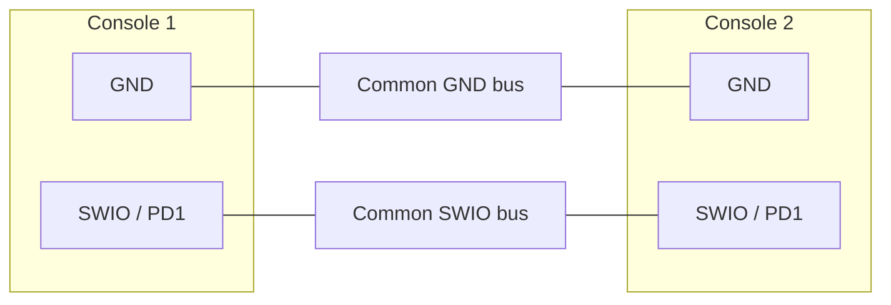
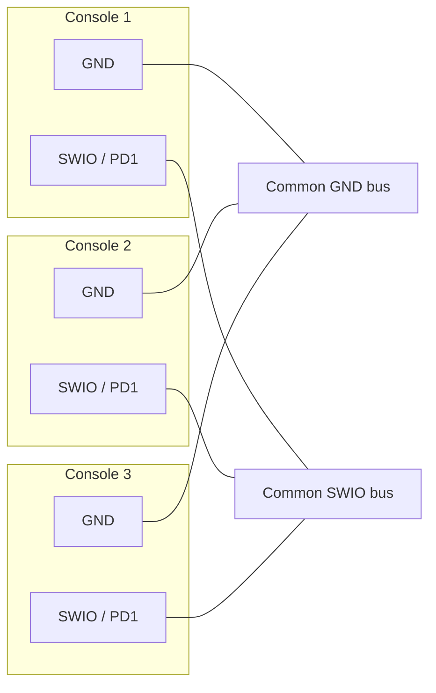
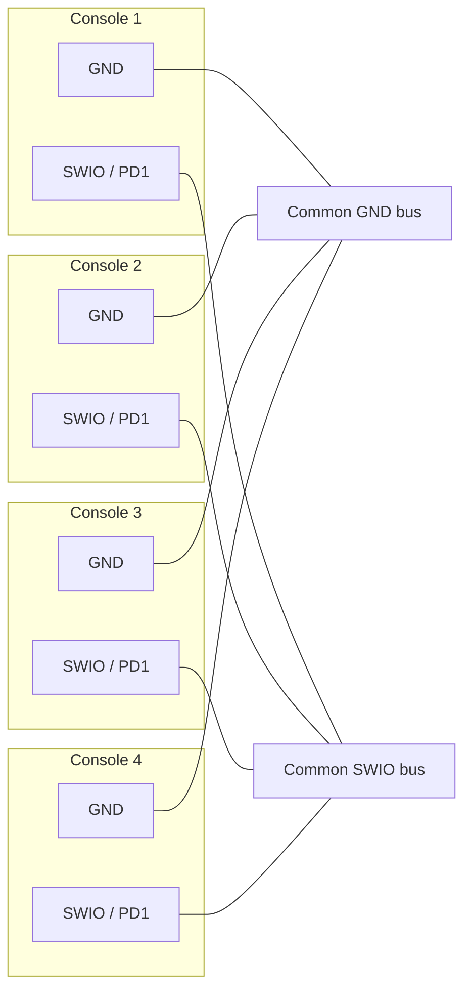

# Parallel cable topology

These are signal diagrams, not connector orientation drawings. Identify the
GND and SWIO labels on each actual board before making the cable. Each console
uses its own normal power source. Leave VCC unconnected. No PCB modification is
proposed. SWIO/PD1 is shared as an open-drain data line; GND is its common reference.

## Two consoles

## Three consoles

## Four consoles

All GND terminals share one conductor. All SWIO terminals share a different
conductor. GND and SWIO are never joined. This is one parallel bus, not a ring
and not separate point-to-point links. Player numbers come from UID arbitration,
not connector position: physical Console 2 can become P3.

## Physical acceptance remains pending

The owner has no consoles yet. The emulator cannot establish electrical operation,
connector orientation, pull-up strength, cable capacitance/length tolerance,
clock drift or programming recovery on real boards. Measure idle/high and low
levels, rise times and bit timing with two, three and four powered consoles;
verify no output drives high against a peer pulling low. Test mixed power states,
power cycles and unplug/replug separately. Hold B at boot to retain the debug pin
and test programming recovery on each physical console before release.
