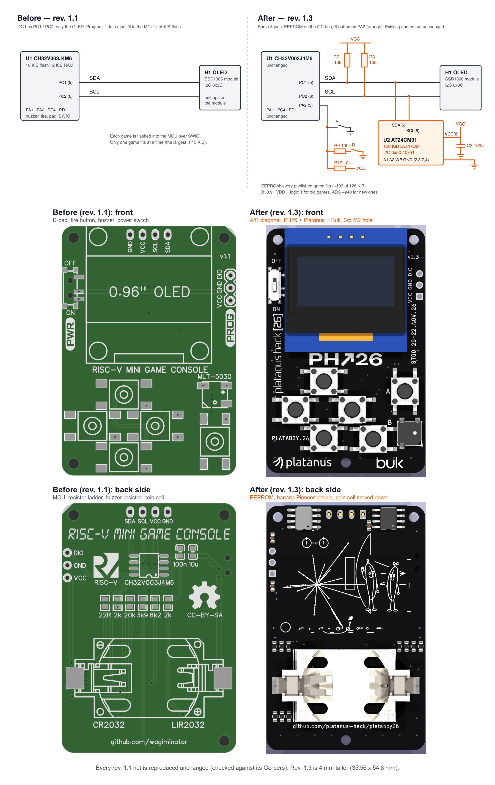

# Board rev. 1.3.1: 128 KiB EEPROM + second action button

Rev. 1.3.1 is the manufactured board. Copper, parts and placement are those of rev. 1.3 (the
silkscreen still reads `v1.3`, and the files in `fab/` keep that name); the `.1` is the
manufacturing package, in which the assembler sources and hand-solders the OLED module
(H1, EB096-01-04G-WB).

Rev. 1.1 is [wagiminator's published board](https://github.com/wagiminator/CH32V003-GameConsole)
(CC BY-SA 3.0). Rev. 1.3 keeps every rev. 1.1 net. All parts keep their rev. 1.1 position except
A (fire) and the buzzer, which move to make room for B. Added parts:

| Ref | Part | LCSC | Why |
|---|---|---|---|
| U2 | AT24CM01-SSHM-T, 1 Mbit I2C EEPROM, SOIC-8 150 mil | C68393 | 128 KiB for games and saves |
| C3 | 100 nF 0603 | C14663 | decoupling for U2 |
| R7, R8 | 10 kΩ 0603 | C25804 | SDA/SCL pull-ups (rev. 1.1 relied on the OLED module's) |
| B | 6×6 mm tact switch (same part as the others) | C23873 | second action button (rev. 1.3) |
| R9 | 100 kΩ 0603 | C25803 | B to PA2 |
| R10 | 10 kΩ 0603 | C25804 | PA2 pull-up |

**Rev. 1.2** added the EEPROM. **Rev. 1.3** adds B, with A up-right, B
down-left and the buzzer in the bottom-right corner, all on the front.

U2 sits on the existing OLED bus (PC1 = SDA, PC2 = SCL), so no MCU pin changes. A1 = A2 = WP = GND,
which puts it at I2C address **0x50** (lower 64 KiB) and **0x51** (upper 64 KiB), next to the
OLED at 0x3C, and keeps it writable.

**B shares PA2 with A** (all 8 pins are in use). A pulls PA2 to 0 V; B pulls it to 0.91 VDD
through R9 against R10. Every existing game reads PA2 as a digital input and keeps working:
to it, B is "not pressed". New games read B with the ADC (PA2 = channel A0):
`JOY_b_pressed()` in `games/template/src/driver.h`. Idle reads about 1023, B 924–954, A 0. **A and B
pressed together read as A**; B with any direction works. The first assembled boards read idle
lower than computed (972 on the sample board), so the driver samples PA2 with the long ADC
sample time and decides B relative to the idle level each board learns, not a fixed window.

**Do not order** C36057 (AT24CM01-**SHD**-T). It is the 208 mil wide body and won't fit the
footprint. Second source: ST M24M01-RMN6TP (same pinout). The 24LC1025 is **not** pin compatible.

## Files

| | |
|---|---|
| `release/plataboy26_v1.3.1_manufacturing.zip` | **the package sent to the fab**: order sheet, Gerbers, BOM/CPL, assembly drawings, renders, STEP, KiCad source |
| `fab/console_v1.3_gerbers.zip` | Gerbers + Excellon drill (2 layers, 35.56 × 54.8 mm, 1.6 mm) |
| `fab/console_v1.3_bom.csv`, `fab/console_v1.3_cpl.csv` | BOM and pick-and-place in JLCPCB format (H1 = OLED module, hand-soldered) |
| `fab/console.kicad_pcb` + `.kicad_pro` | the board, opens in KiCad 10 |
| `fab/console_v1.3_{top,bottom}.{png,pdf}` | renders / plots |
| `fab/console_v1.3.step` | 3D model of the assembled board for enclosure design (STEP, mm) |
| `doc/3d/` | `viewer.html` + `console_v1.3.glb` (interactive 3D, serve the folder: `python3 -m http.server`), `side_annotated.png`, `iso_*.png`, measured `heights.json` |
| `console.py` | **the circuit** (SKiDL, Python): single source of truth |
| `footprints/lcsc.pretty`, `lcsc.3dshapes`, `lcsc.kicad_sym` | LCSC's own footprints, 3D models and symbols for the BOM part numbers (`easyeda2kicad`), with two fixes applied by `footprints.py` |
| `footprints.py` | OLED header footprint (no LCSC part) + fixes to the LCSC footprints |
| `pcb.py` | placement, outline, silkscreen, GND pours and stitching (KiCad's Python) |
| `verify/` | Gerber net extraction and the checks below |
| `make.sh` | whole pipeline; `doc/make_compare.sh` rebuilds the picture |

`sh make.sh` regenerates everything. It needs `tools/venv` (skidl, gerbonara, numpy,
scipy, pillow), KiCad 10 (`/Applications/KiCad` or the unpacked DMG in `tools/kicad-dl/mnt`),
Java 21 and Freerouting 2.1 (`tools/freerouting`).

## Verification (all automated in make.sh)

1. **The circuit matches the shipped board.** The netlist of the rev. 1.1 board was traced
   from its Gerbers: copper areas on both layers joined through every plated hole. It matches
   `console.py` net for net on all 47 original pins (`verify/check_netlist.py`). This also
   settled what the PDF schematic leaves open: MCU pin 1 orientation, battery tab polarity,
   the live buzzer pad, and which 2 kΩ resistor is the pull-down.
2. **ERC** (SKiDL): no errors or warnings.
3. **Footprints are LCSC's own, and pin meanings agree with LCSC** (`verify/check_footprints.py`).
   Every assembled part uses the footprint LCSC publishes for its part number, which is
   what JLCPCB uses to orient parts. Every pin of U1, U2, the buzzer and the battery holder
   carries the net that LCSC's pin names call for (MCU PC1/SDA, PC2/SCL, PC4/A2 ...;
   EEPROM SDA, SCL, A1/A2/WP; buzzer +/-; the "+" printed on the holder's footprint). This
   check caught a real problem in the first layout: copied from rev. 1.1, the battery
   holder footprint had pad 1 (+) on the opposite tab to LCSC's, so the factory would
   likely have soldered the holder in reverse. It also caught two flaws in LCSC's
   converted footprints (plated peg holes on the slide switch, header silkscreen off the
   board), which `footprints.py` fixes.
4. **Placement:** every rev. 1.1 part is placed so that its pads land on the rev. 1.1 pads.
   The offset is at most 0.25 mm, except the battery tabs, where LCSC's pads sit 0.6 mm further in
   than rev. 1.1's. Both overlap the holder's tabs (LCSC: 31.3 mm lead span).
5. **DRC** (KiCad, JLCPCB/PCBWay standard rules: 0.15 mm clearance and track, 0.3 mm
   drill): 0 violations, 0 unconnected pads. The router is retried until this holds.
6. **The fab files implement the circuit.** The generated Gerbers are traced again
   and compared with the netlist: 85 pins, 22 nets, exact match (`verify/check_fab.py`).
   A deliberate SDA/SCL swap is reported as a mismatch, so the check does catch errors.
7. **Electrical budget** (AT24CM01 datasheet):
   - Supply: 1.7 to 5.5 V covers CR2032 (3.0 V) and LIR2032 (3.6 V).
   - Current: 3 µA standby at 3.6 V, 2 mA while reading; zero with the power switch off.
   - Bus: R7/R8 (10 kΩ) in parallel with the module's typical 4.7 kΩ give about 3.2 kΩ. With
     about 50 pF on the bus, the rise time is about 0.14 µs, under the 0.3 µs fast-mode limit;
     the sink current is 1.1 mA, under the 3 mA limit. Without the module, 10 kΩ alone gives
     0.42 µs, enough to program the EEPROM at 100 kHz.
   - Write cycle: 5 ms maximum, with acknowledge polling. Endurance: 1 M cycles.
7b. **Buttons, worst case** (`verify/check_buttons.py`, CH32V003 datasheet V1.1, tables 3-16
   and 3-24). The check covers 1 % resistors, internal pull-up 35–55 kΩ or off, supply 2.8–3.6 V,
   and ADC error ±4 LSB:
   - B alone gives at least 2.54 V at 2.8 V supply. VIH is 1.71 V, so old games never see B.
   - A gives 0 V, below VIL.
   - The ADC reads B at 924–954 with idle at 1019 or more, and A at most 4. B is decided against
     the idle level the board learns; the check passes for idle 1023 and for 972 (the sample board).
   - The PA2 source impedance is 9.0 kΩ, under the 10 kΩ the ADC accuracy figures assume.
   - All 8 joypad directions and diagonals stay inside their decoding windows.
   - Simulator: `games/board_test` decodes every button and combination. All 13
     published games produce the identical final frame with B held for the whole run.
8. **Firmware against the model, and the model against the vendor:** `games/eeprom_test`
   passes in the simulator (AT24CM01 model including tWR NACKs and the 0x51 bank). To
   check the simulator independently of my own code, WCH's official CH32V003 example
   `EVT/EXAM/I2C/I2C_EEPROM` (silicon-tested by the vendor; changed only to 16-bit
   addressing and a 6 ms write delay for this chip) runs unmodified and reads back
   "CH32V00x I2C TEST". `EE_read_safe()` reproduces WCH's exact read sequence as a
   fallback for the loader (CRC check, then retry), in case the fast sequential read
   behaves differently on silicon.

## Artwork (silkscreen)

**Colours:** black solder mask, white silkscreen. They are written into the board's stackup
(`pcb.py colours`), but Gerbers carry no colour, so **select "Black" solder mask and "White"
silkscreen in the fab's order form.**

- **Front (layout A3):**
  - PH↗26 under the screen.
  - "platanus hack [26]" along the left edge and "STGO 20-22.NOV.26" along the right edge.
  - PLATABOY.26 left of the DOWN button.
  - The full Platanus logo and Buk in the bottom strip, either side of the centre hole. Rev. 1.3 is 4 mm taller than rev. 1.1 (35.56 × 54.8 mm). Its three M2 holes
  (2.2 mm) sit at the top corners and the bottom centre, for a 3D-printed enclosure.
  - Sources are in `doc/art/logos/`, converted by `logos_to_silk.py`; placement is
    `FRONT_LOGOS` in `pcb.py`; `front_preview.py` tries other layouts on the routed board.
- **Back:** the banana Pioneer plaque, 30 × 23.8 mm (`doc/art/make_plaque.py` →
  `art_to_silk.py`). No back-side tracks or vias run under it.
- **Print limits:**
  - Lines thinner than about 0.15 mm do not print.
  - Buk stays clean down to about 1.5 mm tall, and the Platanus mark down to 2.0 mm
    (`doc/art/small_logo_sizes.png`).
  - The "platanus" lettering is 0.03 mm bolder than the brand font so that it prints at 1.75 mm.
- **Back:** "github.com/platanus-hack/plataboy26" under the coin cell. The CC BY-SA credit to
  wagiminator's original design lives in that repository's README.
- **3D mockup:** `sh doc/3d/build.sh` builds `doc/3d/index.html` + `console_v1.3.glb`.
  `fix_glb.py` makes the mask opaque and lifts the silkscreen so browsers draw it cleanly.
  Serve the folder with `python3 -m http.server`. `fab/console_v1.3.step` is the board for CAD.

## Heights (measured from the 3D models)

| Front, above the board | | Back, below the board | |
|---|---|---|---|
| programming header H2 | 8.5 mm | CR2032 holder | 5.6 mm |
| buttons A, B, D-pad | 6.0 mm | EEPROM U2 | 1.8 mm |
| OLED glass (module on 2.5 mm header) | 4.9 mm | everything else | < 1.8 mm |
| power switch / buzzer | 3.2 / 2.0 mm | | |

All six buttons are the same part and the same height, 1.1 mm above the screen glass. Total
thickness is 13.2 mm. The 3-pin programming header adds 2.5 mm on top. Leave it unfitted in
production (program through pogo pins or a clip) unless the enclosure leaves room for it.

## What software cannot prove

- That JLCPCB's placement preview shows every part correctly; look at it before paying.
  With LCSC footprints it should, but U1, U2, B1 and the buzzer are worth a glance.
- Analog and mechanical reality: OLED module pinout from your supplier (must be
  GND VCC SCL SDA), switch feel, battery contact, enclosure fit.

## Bring-up

Flash `games/board_test` on a new board. Expected: "EEPROM PASS", and each button lights its
own letter. "AB" reads about 1023 idle, about 940 with B, and 0 with A (see the note on the
learned idle level above). The joypad ladder is calibrated per board by the menu firmware at
power-on (`games/common/joycal.h`, checked by `verify/check_joycal.py`).
